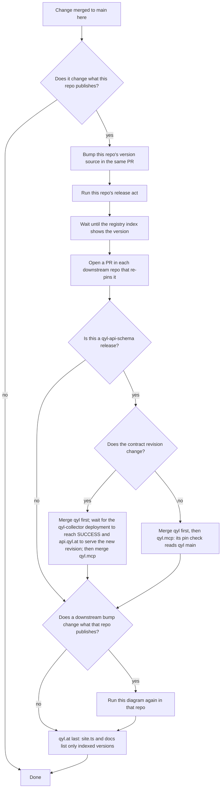

# Qyl.OpenTelemetry.AutoInstrumentation

## Release ripple across the qyl-dev repos

This section is identical in the `AGENTS.md` of all six qyl-dev repos (qyl-api-schema, Qyl.OpenTelemetry.SemanticConventions, Qyl.OpenTelemetry.AutoInstrumentation, qyl, qyl.mcp, qyl.at). Change it in all six in one sweep.

A merge or a release here is done only when the ripple is done: every downstream repo pins the new version on `main`, every downstream repo that had to re-release is published and indexed, and qyl.at lists only indexed versions.

When two producers feed one consumer (SemanticConventions and AutoInstrumentation both feed qyl), wait until both are indexed and re-pin them in one qyl PR.

Downstream edges: when a producer is indexed, the consumer re-pins it at these files in one PR.

| Producer (registry) | Consumer: files to re-pin |
|---|---|
| qyl-api-schema: `Qyl.Api.Contracts` (NuGet) and `@ancplua/qyl-api-schema` (npm) | qyl: `Version.props` `QylApiContractsVersion`, `services/qyl.dashboard/package.json`, `services/qyl.dashboard/bun.lock`, the `README.md` table. The collector compiles against this package and advertises its contract revision. |
| | qyl.mcp, after qyl's `main` carries it: `server/package.json`, `workbench/package.json`, `dashboard/package.json`, `bun.lock` |
| SemanticConventions: `Qyl.Telemetry.SemanticConventions`, `.Incubating`, `.Analyzers` (NuGet) | AutoInstrumentation: `Directory.Packages.props`, `SEMCONV_REF` in `live-check.yml`, `ref:` in `nuget-publish.yml` |
| | qyl: `Version.props` `QylSemanticConventionsVersion` |
| | qyl.at: `public/schemas/<version>` (served before the SemanticConventions tag is pushed) |
| AutoInstrumentation: `Qyl.Telemetry.Hosting`, `Qyl.Telemetry.AutoInstrumentation*` (NuGet) | qyl: `Version.props` `QylTelemetryVersion` |
| qyl: `qyl`, `qyl.<rid>` ×6, `Qyl.Api.Sdk` (NuGet); collector at `api.qyl.at` | qyl.mcp: its CI builds the collector from qyl `main`, and `mcp.qyl.at` refuses a collector with another contract revision |
| qyl.mcp: `qyl-mcp-server` (npm); server at `mcp.qyl.at` | qyl: the `qyl-mcp-server` row in `README.md`, which isn't rendered |
| every producer above | qyl.at: `src/data/site.ts` (the `release` list and the `headline` footer, one wave date), `src/content/docs/api-sdk.mdx`, `src/content/docs/getting-started.mdx` |

Release acts. The version source changes in the PR; the act runs after it merges.

| Repo | Version source | Release act | Index wait |
|---|---|---|---|
| qyl-api-schema | the tag only | `gh release create vX.Y.Z --target <sha> --title vX.Y.Z --notes …` | the workflow waits for npm and NuGet |
| SemanticConventions | `Directory.Build.props` `VersionPrefix` and a `CHANGELOG.md` entry | `git tag vX.Y.Z <sha> && git push origin vX.Y.Z` | none: poll `https://api.nuget.org/v3-flatcontainer/qyl.telemetry.semanticconventions/index.json` yourself |
| AutoInstrumentation | `Directory.Build.props` `Version` | push tag `v<Version>` | the workflow waits for NuGet |
| qyl | `Version.props` `QylVersion`; bump it before the first package-affecting commit after a release | push tag `v<QylVersion>`; the workflow creates the GitHub release | the workflow waits for NuGet |
| qyl.mcp | `server/package.json` `version`, plus a `server/README.md` release-notes entry | `gh release create vX.Y.Z --target <sha> --title X.Y.Z --notes …` | the workflow smokes the published package with `npx` |
| qyl.at | none | merging to `main` deploys `qyl.at` | — |

Merging to `main` also deploys: qyl → `qyl-collector` (`api.qyl.at`, Railway), qyl.mcp → `qyl-mcp` (`mcp.qyl.at`, Railway), qyl.at → the `qyl-at` Worker (`qyl.at`, Cloudflare).
